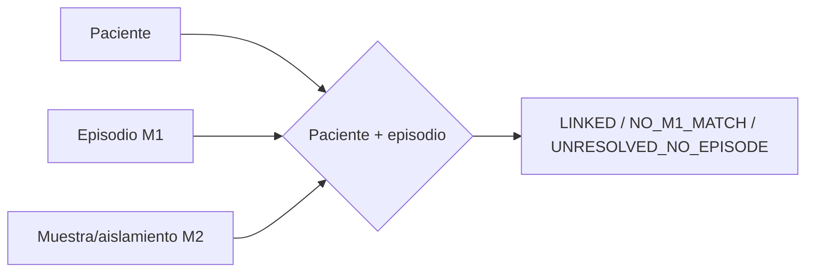

# Integración M1 ↔ M2

## CURRENT de código

La asociación contextual E2 utiliza paciente y episodio. Conserva varias
alertas M1 del mismo episodio y no escoge la primera. El tratamiento y el
fármaco siguen siendo datos de la alerta M1, pero no son la causa ni la clave
causal de un aislamiento M2. La relación se presenta como contexto compartido
y nunca como causalidad tratamiento-cultivo.

El aislamiento se toma de `isolates_classified.csv`, no solo de los miembros
de alerta, por lo que los aislamientos no relevantes también permanecen
visibles. Los estados son `LINKED`, `NO_M1_MATCH` y
`UNRESOLVED_NO_EPISODE`; en ningún caso se inventa un episodio.

## Limitación

La disponibilidad de producción sigue fuera de alcance. La validación E2 usa
datos sintéticos explícitos y no representa pacientes reales ni causalidad
terapéutica.

## Estado de la campaña MM29/R98

La disponibilidad del feed real en E2 y el circuito diario M2 candidato sí han
quedado validados. No se ha observado una alerta MDRO positiva real con
correspondencia simultánea en M1 (`REAL_MDRO_POSITIVE_OBSERVED=NO`). La
validación funcional E2 se cerró con una fixture sintética compartida, sin
elevar ese resultado sintético a evidencia clínica real.

## Entrega E2 2026-11-11

- Backend: `34f0936` publicado en `origin/release/e2-mm17`.
- Frontend: `96f76d3` publicado en `origin/release/e2-mm17`.
- E2 activo: backend `34f0936-mdro-status-20261111`, frontend
  `9b50449-mm2-context-20261111`.
- Smoke de servicios y navegador/UAT: PASS.
- Rollback al release previo y restore al nuevo release: PASS.
- Producción: intacta y solo lectura.
- El run real `20261111T165416Z` contiene 185 aislamientos, 9 MDRO, 176
  no-MDRO, 0 alertas y 16 aislamientos sin episodio resoluble.
- El run QA compartido `SYN-M1M2-MM29-R98-SHARED-20261111` contiene 8
  aislamientos, 3 MDRO, 5 no-MDRO, 4 contextos M1, 4 sin contexto y 2
  aislamientos con múltiples alertas M1 del mismo episodio.
- El caso QA incluye además un mismo paciente en otro episodio sin vínculo.
- Formulación funcional: “Módulo 2 visualiza los aislamientos microbiológicos
  con independencia de que cumplan criterios MDRO. Cuando un aislamiento y
  una alerta de tratamiento de Módulo 1 comparten de forma estructurada
  paciente y episodio, la interfaz permite navegación contextual bidireccional
  entre ambos módulos. Esta asociación representa pertenencia al mismo
  contexto asistencial y no implica causalidad entre el aislamiento y un
  tratamiento concreto.”

## Presentación clínica MM29/R98 — 2026-11-12

La trazabilidad de etiquetas queda separada de la identidad técnica. Layer1
produce `sample_type_model` desde `muestra_label` y produce
`germen_label_original`, `germen_label` y `germen_normalized` en la tabla de
organismos. El output Layer2 conserva `sample_type` y `organism_normalized`,
pero la versión QA observada también podía llegar solo con `sample_pk` y
`organism_pk`; esa pérdida se localiza en el contrato de entrada/publicación de
Layer2, no en la generación de las claves de Layer1.

El backend publica `sample_display_name` y `organism_display_name` sin
sobrescribir `sample_pk` ni `organism_pk`. La UI muestra primero la etiqueta
clínica y deja los identificadores técnicos en una sección secundaria de
trazabilidad. Si el feed no entrega etiqueta, se muestra `No disponible` y no
se convierte un ID surrogate en texto clínico.

El banner persistente de M1 conserva, para cada aislamiento, microorganismo,
muestra, fecha, S/R/I y semántica `MDRO`/`NO MDRO`; los valores S/R/I vacíos
siguen siendo conjuntos vacíos y `No informado` queda reservado a ausencia.
La navegación continúa siendo bidireccional por paciente+episodio y conserva
el contexto al entrar en R98. La fixture sintética compartida mantiene casos
QA visibles separados de los datos reales.

La corrección está versionada en backend `9a4f05e` y frontend `4e2b21c`,
publicados sin force push en `origin/release/e2-mm17`. El backend propaga
`organism_normalized` como último alias de `organism_display_name` cuando las
columnas de etiqueta de Layer1 no están presentes; los identificadores
`sample_pk` y `organism_pk` permanecen separados como trazabilidad técnica.
La UI M1/M2 conserva el fallback `No disponible` cuando el feed no contiene
organismo y no convierte IDs en nombres clínicos.

El despliegue E2 de la corrección y la validación posterior fueron PASS:
smoke, UAT API, UAT browser, navegación bidireccional M1↔M2, recorrido R98
completo, reevaluación tras modificar el tratamiento, rollback y restore.
El run real mantuvo 185 aislamientos, 9 MDRO y 176 no-MDRO; dos filas sin
organismo de origen permanecen sin etiqueta por ausencia legítima de fuente.
Producción no se modificó.

## Casos QA visibles y persistencia completa — 2026-11-12

E2 publica dos casos sintéticos encontrables desde la lista M1 normal en
`http://10.100.10.203/e2/`:

- `CASO QA M1-M2 · NO MDRO`: paciente
  `SYN-M1M2-CASE4-001`, episodio `SYN-M1M2-CASE4-EP1`, run
  `SYN-M1M2-MM29-R98-QA-NO-MDRO-20261112`, `ESCHERICHIA COLI`, muestra
  `Orina - Urocultivo`, clase `NOT_MDR`, S=`AMOXICILLIN, CEFTRIAXONE`, R/I
  vacíos.
- `CASO QA M1-M2 · MDRO`: paciente `SYN-M1M2-CASE2-001`, episodio
  `SYN-M1M2-CASE2-EP1`, run `SYN-M1M2-MM29-R98-SHARED-20261111`,
  `STAPHYLOCOCCUS AUREUS`, muestra `synthetic`, clase `MRSA`, S=`MEROPENEM`,
  R=`CEFOXITINA, CEFTRIAXONA`, I vacío.

Los nombres humanos aparecen por defecto, junto al marcador sintético y la
clasificación MDRO/NO MDRO. El contexto permanece visible en M1 antes de
R98, durante la evaluación completa, en la recomendación persistida y tras
recargar. M1 abre el aislamiento exacto en M2; M2 vuelve a M1 con paciente,
episodio y run conservados. La UI declara siempre que es contexto compartido,
no causalidad tratamiento-cultivo.

El cambio está en backend `c615b8a` y frontend `f018b4d`, desplegado en E2
con backend `c615b8a-mm29-r98-qa-labels-20261112` y frontend
`f018b4d-mm29-r98-qa-labels-20261112`. Backend completo: `200 tests, 0
failures, 0 errors, 15 skipped`; frontend completo: `27 suites, 241 tests`;
build E2: `b3101c20737ee817`. Rollback y restore controlados fueron PASS.
Producción, datos reales y monitor de email permanecieron intactos.

## Presentación microbiológica por defecto — 2026-11-13

La corrección visual posterior mantiene la integración M1↔M2 y solo cambia la
presentación del contexto microbiológico: cada aislamiento aparece por defecto
en una tarjeta clínica compacta expandida, sin requerir un clic para mostrar
microorganismo, muestra, fecha, MDRO/no-MDRO y S/R/I. Los identificadores
técnicos quedan bajo `Trazabilidad`, como información secundaria. Se conservan
las tarjetas independientes para múltiples aislamientos y la semántica de
conjuntos S/R/I vacíos frente a valores no informados.

La validación browser de los dos casos sintéticos confirmó la persistencia del
contexto durante el recorrido R98, la navegación Atrás/Modificar tratamiento,
la segunda recomendación y la navegación por teclado. El rollback al release
previo y la restauración del candidato mantuvieron el endpoint E2 disponible;
backend, fixture y producción no se modificaron.

## Cierre operativo E2 y determinismo temporal — 2026-11-13

El único fallo backend sensible al calendario se corrigió mediante un reloj
controlable en pruebas; el reloj por defecto sigue siendo el de operación
`Europe/Madrid`. La matriz cubre día actual, día anterior, múltiples runs,
históricos y cambios de día, mes, año y zona horaria, sin modificar la lógica
clínica ni la selección operativa. El cambio backend corresponde a `b16bad7`.

El backend `b16bad7` y el frontend `c0ff895` quedaron restaurados mediante los
servicios E2 normales. El rollback al release anterior y el restore del
candidato se verificaron con ambos servicios activos, salud backend UP,
`/e2/`, `/e2/m2` y `/e2/proa` disponibles, releases candidatas correctas y sin
proceso temporal duplicado. Producción y el monitor de email permanecieron
intactos.

La validación browser final confirmó el contexto microbiológico MDRO visible
por defecto, la recomendación R98, la persistencia técnica, la reevaluación y
la conservación del contexto al volver atrás. El resultado clínico de prueba
fue `Reevaluar vancomicina antes de añadir otro antibiótico`.
