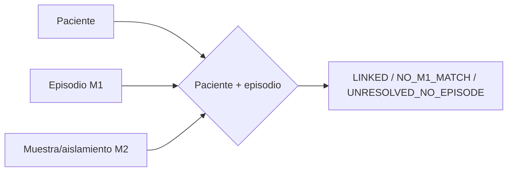

# Integración M1 ↔ M2

## CURRENT de código

La asociación contextual E2 utiliza paciente y episodio. Conserva varias
alertas M1 del mismo episodio y no escoge la primera. El tratamiento y el
fármaco siguen siendo datos de la alerta M1, pero no son la causa ni la clave
causal de un aislamiento M2. La relación se presenta como contexto compartido
y nunca como causalidad tratamiento-cultivo.

El aislamiento se toma de `isolates_classified.csv`, no solo de los miembros
de alerta, por lo que los aislamientos no relevantes también permanecen
visibles. Los estados son `LINKED`, `NO_M1_MATCH` y
`UNRESOLVED_NO_EPISODE`; en ningún caso se inventa un episodio.

## Limitación

La disponibilidad de producción sigue fuera de alcance. La validación realizada
en E2 no inventó correlaciones: las fixtures sintéticas actuales exponen
claves M2 `SYN-PAT-*`, mientras la fuente M1 sintética disponible expone
`SYN-M1M2-*`; por ello no se declara vínculo positivo en esos runs.

## Estado de la campaña MM29/R98

La disponibilidad del feed real en E2 y el circuito diario M2 candidato sí han
quedado validados. En los lotes reales utilizados no apareció una alerta MDRO
positiva con correspondencia simultánea en M1; por ello el flujo browser real
M2 → M1 → R98 permanece pendiente de un caso natural y no se declara como
validado. La regla de matching sigue siendo estructurada: paciente RAW4 más
episodio RAW1 validado, sin first match y sin asociación automática en caso
ambiguo.

## Entrega E2 2026-11-11

- Backend: `2c5ff05` publicado en `origin/release/e2-mm17`.
- Frontend: `9b50449` publicado en `origin/release/e2-mm17`.
- E2 activo: backend `2c5ff05-mm2-context-20261111`, frontend
  `9b50449-mm2-context-20261111`.
- Smoke de servicios y navegador/UAT: PASS.
- Rollback al release previo y restore al nuevo release: PASS.
- Producción: intacta y solo lectura.
- La ejecución activa observada en E2 contiene 507 aislamientos; R26 contiene
  8. No se encontró en el output E2 disponible la ejecución esperada de 185,
  por lo que `MASTER_GATE` permanece bloqueado y no se afirma una cobertura
  de 185 ni un positivo real inexistente.
