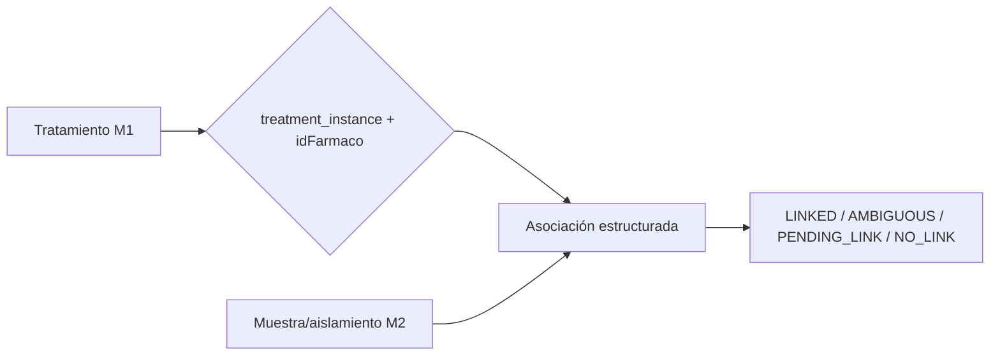

# Integración M1 ↔ M2

## CURRENT de código

La asociación E2 exige identidad de tratamiento y producto; usa paciente/episodio/asistencia/orden/línea junto con muestra o aislamiento. No realiza matching por nombre, fármaco solo o primera coincidencia.

## Limitación

La disponibilidad real de muestras y aislados en producción no quedó validada porque HP-3 no fue accesible y el endpoint M2 E2 respondió 500. No se inventaron correlaciones.
