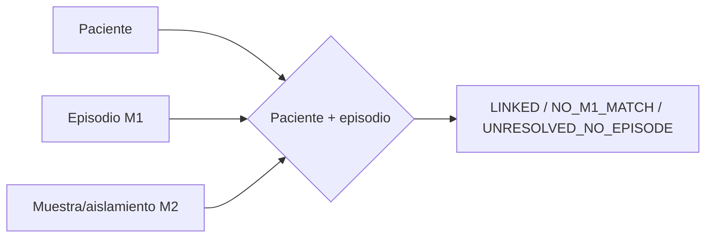

# Integración M1 ↔ M2

## CURRENT de código

La asociación contextual E2 utiliza paciente y episodio. Conserva varias
alertas M1 del mismo episodio y no escoge la primera. El tratamiento y el
fármaco siguen siendo datos de la alerta M1, pero no son la causa ni la clave
causal de un aislamiento M2. La relación se presenta como contexto compartido
y nunca como causalidad tratamiento-cultivo.

El aislamiento se toma de `isolates_classified.csv`, no solo de los miembros
de alerta, por lo que los aislamientos no relevantes también permanecen
visibles. Los estados son `LINKED`, `NO_M1_MATCH` y
`UNRESOLVED_NO_EPISODE`; en ningún caso se inventa un episodio.

## Limitación

La disponibilidad de producción sigue fuera de alcance. La validación E2 usa
datos sintéticos explícitos y no representa pacientes reales ni causalidad
terapéutica.

## Estado de la campaña MM29/R98

La disponibilidad del feed real en E2 y el circuito diario M2 candidato sí han
quedado validados. No se ha observado una alerta MDRO positiva real con
correspondencia simultánea en M1 (`REAL_MDRO_POSITIVE_OBSERVED=NO`). La
validación funcional E2 se cerró con una fixture sintética compartida, sin
elevar ese resultado sintético a evidencia clínica real.

## Entrega E2 2026-11-11

- Backend: `34f0936` publicado en `origin/release/e2-mm17`.
- Frontend: `96f76d3` publicado en `origin/release/e2-mm17`.
- E2 activo: backend `34f0936-mdro-status-20261111`, frontend
  `9b50449-mm2-context-20261111`.
- Smoke de servicios y navegador/UAT: PASS.
- Rollback al release previo y restore al nuevo release: PASS.
- Producción: intacta y solo lectura.
- El run real `20261111T165416Z` contiene 185 aislamientos, 9 MDRO, 176
  no-MDRO, 0 alertas y 16 aislamientos sin episodio resoluble.
- El run QA compartido `SYN-M1M2-MM29-R98-SHARED-20261111` contiene 8
  aislamientos, 3 MDRO, 5 no-MDRO, 4 contextos M1, 4 sin contexto y 2
  aislamientos con múltiples alertas M1 del mismo episodio.
- El caso QA incluye además un mismo paciente en otro episodio sin vínculo.
- Formulación funcional: “Módulo 2 visualiza los aislamientos microbiológicos
  con independencia de que cumplan criterios MDRO. Cuando un aislamiento y
  una alerta de tratamiento de Módulo 1 comparten de forma estructurada
  paciente y episodio, la interfaz permite navegación contextual bidireccional
  entre ambos módulos. Esta asociación representa pertenencia al mismo
  contexto asistencial y no implica causalidad entre el aislamiento y un
  tratamiento concreto.”

## Presentación clínica MM29/R98 — 2026-11-12

La trazabilidad de etiquetas queda separada de la identidad técnica. Layer1
produce `sample_type_model` desde `muestra_label` y produce
`germen_label_original`, `germen_label` y `germen_normalized` en la tabla de
organismos. El output Layer2 conserva `sample_type` y `organism_normalized`,
pero la versión QA observada también podía llegar solo con `sample_pk` y
`organism_pk`; esa pérdida se localiza en el contrato de entrada/publicación de
Layer2, no en la generación de las claves de Layer1.

El backend publica `sample_display_name` y `organism_display_name` sin
sobrescribir `sample_pk` ni `organism_pk`. La UI muestra primero la etiqueta
clínica y deja los identificadores técnicos en una sección secundaria de
trazabilidad. Si el feed no entrega etiqueta, se muestra `No disponible` y no
se convierte un ID surrogate en texto clínico.

El banner persistente de M1 conserva, para cada aislamiento, microorganismo,
muestra, fecha, S/R/I y semántica `MDRO`/`NO MDRO`; los valores S/R/I vacíos
siguen siendo conjuntos vacíos y `No informado` queda reservado a ausencia.
La navegación continúa siendo bidireccional por paciente+episodio y conserva
el contexto al entrar en R98. La fixture sintética compartida mantiene casos
QA visibles separados de los datos reales.
