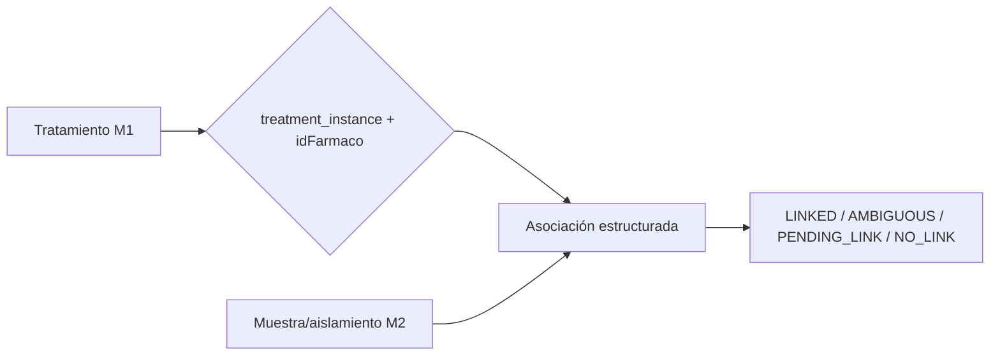

# Integración M1 ↔ M2

## CURRENT de código

La asociación E2 exige identidad de tratamiento y producto; usa paciente/episodio/asistencia/orden/línea junto con muestra o aislamiento. No realiza matching por nombre, fármaco solo o primera coincidencia.

## Limitación

La disponibilidad real de muestras y aislados en producción no quedó validada porque HP-3 no fue accesible y el endpoint M2 E2 respondió 500. No se inventaron correlaciones.

## Estado de la campaña MM29/R98

La disponibilidad del feed real en E2 y el circuito diario M2 candidato sí han
quedado validados. En los lotes reales utilizados no apareció una alerta MDRO
positiva con correspondencia simultánea en M1; por ello el flujo browser real
M2 → M1 → R98 permanece pendiente de un caso natural y no se declara como
validado. La regla de matching sigue siendo estructurada: paciente RAW4 más
episodio RAW1 validado, sin first match y sin asociación automática en caso
ambiguo.
