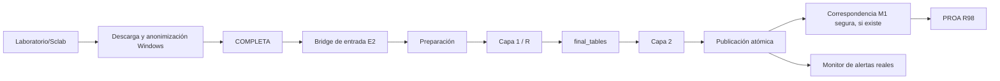

# Consolidación MM29/R98 y Módulo 2

Estado documental vigente de la campaña. Este documento no sustituye el
runbook de despliegue ni contiene datos clínicos, secretos o identificadores
de infraestructura.

## Estado de aceptación

- `M2_DAILY_PIPELINE_READINESS=PASS`.
- `M2_REAL_POSITIVE_MATCH_READINESS=WAITING_FOR_NATURAL_REAL_CASE`.
- `MASTER_GATE=BLOCKED_REAL_WORLD_POSITIVE_MATCH_NOT_AVAILABLE`.
- `READY_FOR_JUAN_VALIDATION=NO`.
- `JUAN_ACTION_REQUIRED=NONE`.

El estado no representa un defecto técnico: el circuito diario está operativo
y validado. La condición pendiente es la aparición natural de un caso MDRO
real con correspondencia M1 segura.

## Arquitectura diaria demostrada

La tarea Windows funciona a las 09:00. E2 sondea cada 10 minutos, espera que
la entrada sea estable y compara un watermark de la colección de ficheros.
La hora exacta de descarga queda desacoplada del procesamiento posterior.
No se modificó la tarea Windows ni se solicitó ninguna credencial.

## Contrato RAW

- `RAW1`: `episodio_origen`, contexto de episodio añadido o calculado durante
  la anonimización para ingresados cuando está disponible.
- `RAW4`: código de paciente, conservado como identidad de paciente sin
  coerción.
- `RAW9`: fecha de muestra.
- `RAW10–15`: campos microbiológicos confirmados utilizados por el contrato.
- `RAW2` y `RAW3`: permanecen opacos; no se les asigna semántica autoritativa.
- Sclab no aporta un identificador hospitalario de petición; no se inventan
  `xid_peticion` ni `xpeticion_id`.

No se asignan tratamientos por paciente, fecha o medicación aislados.

## Identidad y correspondencia M1

Cuando exista una alerta MDRO real, el enlace M1 debe utilizar RAW4 más RAW1
validado, o una resolución estructurada inequívoca. No se utiliza la primera
coincidencia. Si no hay correspondencia, se conserva `MDRO_REAL=YES` y
`M1_MATCH=NO`. Si hay más de un candidato, el caso queda ambiguo y no se
enlaza automáticamente.

La correspondencia M1 no ejecuta acciones terapéuticas automáticas.

## Validación realizada

El run real publicado más reciente produjo:

- 185 aislados;
- 0 alertas MDRO;
- 0 aislados relevantes para alerta;
- 0 miembros de alerta.

El cero fue validado como resultado legítimo: Layer1 produjo `READY` y tablas
finales no vacías; Layer2 generó manifiesto, evaluación y artefactos completos;
la publicación fue atómica; el replay produjo hashes iguales. No fue un
dataset vacío, un fallo de R, un fallo de parser ni un fallo de Layer2.

## Operación y seguridad

- El bridge utiliza el recurso Windows ya disponible y su subruta de entrada
  autoritativa; no crea un fetcher paralelo ni nuevas credenciales.
- El watermark registra fichero detectado, huella de entrada, último run,
  outcome y timestamp.
- Un run incompleto no sustituye el run publicado anterior.
- El monitor de correo solo evalúa un run Layer2 publicado y con provenance
  real; no reacciona a un fichero nuevo, a Layer1 terminado, a pacientes M1 ni
  a fixtures.
- Producción permanece estrictamente read-only.

## R98 y validación pendiente

La evidencia funcional previa de R98 se conserva. La navegación browser del
caso real M2→M1→R98 no se declara hasta que aparezca un positivo MDRO real con
correspondencia M1 segura.

## Evidencias

La trazabilidad completa requisito → implementación → validación → estado se
conserva en `HERRAMIENTAS/evidence/mm29-r98-20261106.md`. El bloque apto para
memoria se mantiene separado en `MEMORIA_CDTI_M2_DAILY_FLOW.md`.
