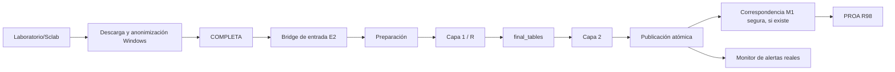

# Consolidación MM29/R98 y Módulo 2

Estado documental vigente de la campaña. Este documento no sustituye el
runbook de despliegue ni contiene datos clínicos, secretos o identificadores
de infraestructura.

## Estado de aceptación

- `M2_DAILY_PIPELINE_READINESS=PASS`.
- `M2_REAL_POSITIVE_MATCH_READINESS=NOT_OBSERVED_REAL_CASE`.
- `MASTER_GATE=PASS` (gate técnico/funcional E2; sin afirmar un positivo real).
- `READY_FOR_JUAN_VALIDATION=YES`.
- `JUAN_ACTION_REQUIRED=VALIDATE`.

El circuito diario está operativo y validado. La observación de un caso MDRO
real con correspondencia M1 segura queda como evidencia clínica futura y no es
un requisito para validar la fixture sintética QA controlada.

## Arquitectura diaria demostrada

La tarea Windows funciona a las 09:00. E2 sondea cada 10 minutos, espera que
la entrada sea estable y compara un watermark de la colección de ficheros.
La hora exacta de descarga queda desacoplada del procesamiento posterior.
No se modificó la tarea Windows ni se solicitó ninguna credencial.

## Contrato RAW

- `RAW1`: `episodio_origen`, contexto de episodio añadido o calculado durante
  la anonimización para ingresados cuando está disponible.
- `RAW4`: código de paciente, conservado como identidad de paciente sin
  coerción.
- `RAW9`: fecha de muestra.
- `RAW10–15`: campos microbiológicos confirmados utilizados por el contrato.
- `RAW2` y `RAW3`: permanecen opacos; no se les asigna semántica autoritativa.
- Sclab no aporta un identificador hospitalario de petición; no se inventan
  `xid_peticion` ni `xpeticion_id`.

No se asignan tratamientos por paciente, fecha o medicación aislados.

## Identidad y correspondencia M1

Cuando exista una alerta MDRO real, el enlace M1 debe utilizar RAW4 más RAW1
validado, o una resolución estructurada inequívoca. No se utiliza la primera
coincidencia. Si no hay correspondencia, se conserva `MDRO_REAL=YES` y
`M1_MATCH=NO`. Si hay más de un candidato, el caso queda ambiguo y no se
enlaza automáticamente.

La correspondencia M1 no ejecuta acciones terapéuticas automáticas.

## Validación realizada

El run real publicado más reciente produjo:

- 185 aislados;
- 0 alertas MDRO;
- 0 aislados relevantes para alerta;
- 0 miembros de alerta.

El cero fue validado como resultado legítimo: Layer1 produjo `READY` y tablas
finales no vacías; Layer2 generó manifiesto, evaluación y artefactos completos;
la publicación fue atómica; el replay produjo hashes iguales. No fue un
dataset vacío, un fallo de R, un fallo de parser ni un fallo de Layer2.

## Operación y seguridad

- El bridge utiliza el recurso Windows ya disponible y su subruta de entrada
  autoritativa; no crea un fetcher paralelo ni nuevas credenciales.
- El watermark registra fichero detectado, huella de entrada, último run,
  outcome y timestamp.
- Un run incompleto no sustituye el run publicado anterior.
- El monitor de correo solo evalúa un run Layer2 publicado y con provenance
  real; no reacciona a un fichero nuevo, a Layer1 terminado, a pacientes M1 ni
  a fixtures.
- Producción permanece estrictamente read-only.

## R98 y validación pendiente

La evidencia funcional previa de R98 se conserva. La navegación browser del
caso real M2→M1→R98 no se presenta como caso clínico real: el UAT cerrado usa
la identidad sintética compartida `SYN-M1M2-MM29-R98-SHARED-20261111` y deja
visible la etiqueta de caso sintético.

## Evidencias

La trazabilidad completa requisito → implementación → validación → estado se
conserva en `HERRAMIENTAS/evidence/mm29-r98-20261106.md`. El bloque apto para
memoria se mantiene separado en `MEMORIA_CDTI_M2_DAILY_FLOW.md`.

## Cierre técnico E2 2026-11-11

Se publicó el ajuste de integración contextual M1↔M2 en
`origin/release/e2-mm17`: backend `34f0936` y frontend `96f76d3`. El enlace
visible usa paciente+episodio, conserva múltiples alertas M1 del mismo
episodio, muestra todos los aislamientos clasificados y no interpreta la
relación como causalidad tratamiento-cultivo.

La activación E2, el smoke de backend/frontend, el UAT de navegador, el
rollback al release previo y el restore al release nuevo fueron PASS. La
producción no se modificó.

## Corrección final de etiquetas clínicas 2026-11-12

La pérdida observada de `organism_display_name` se localizó en el aliasado del
contrato backend cuando el output publicado conservaba `organism_normalized`
pero no las columnas de etiqueta de Layer1. La corrección no cambia la lógica
clínica ni el runtime: añade `organism_normalized` como último fallback del
modelo de presentación y conserva `sample_pk`/`organism_pk` como identidad
técnica separada.

- Backend: `9a4f05e`, frontend: `4e2b21c`, ambos publicados en
  `origin/release/e2-mm17`.
- E2 activo tras restore: backend
  `9a4f05e-mm29-r98-label-fix-20261112`, frontend
  `4e2b21c-mm29-r98-label-fix-20261112`.
- Backend SHA-256: `6c944cf9c3c1aed6d75a321b9bfcc9b3372161d4df96da6c1798fee338956d9f`.
- Frontend `app.js` SHA-256:
  `53ce64d24cef52c8440e7217a2bb46c65bd0fbd64d31da5823e3e2fb1f3cc876`.
- La fixture sintética compartida conserva su SHA-256
  `35f1d12678441a76202bd5e5c53f3399510234cb86790a1605f9968bffee8839`.
- UAT M1/M2 muestra `STAPHYLOCOCCUS AUREUS`, muestra `synthetic`, MDRO
  `MRSA`, S/R/I y las claves técnicas por separado; la QA E. coli muestra
  `ESCHERICHIA COLI`.
- R98 completo y reevaluación posterior a cambio de tratamiento fueron
  completados en navegador sobre datos sintéticos.
- Rollback al backend `a1887aa-mm29-r98-20261112-rebuilt` y frontend
  `af42889-mm29-r98-20261112`, seguido de restore al candidato corregido:
  PASS.
- Producción permanece intacta. La publicación documental se completa en el
  remoto oficial `https://github.com/babenza/woshealth_documentacion`, sin
  force push.

El E2 accesible expone el run real de 185 y una fixture QA compartida. La
fixture fue creada en un directorio QA separado a partir de una salida generada
por la lógica M2, con claves comunes para M1/M2, casos MDRO y no-MDRO, varios
aislamientos, alertas múltiples y episodio distinto sin vínculo. El run real
no se modificó.

## Cierre QA E. coli y navegación persistente 2026-11-12

Se añadió una copia QA aislada `SYN-M1M2-MM29-R98-ECOLI-QA` sin modificar el
run compartido ni el run real. Contiene 9 aislamientos, incluye el caso
sintético `SYN-M1M2-CASE4-001`/`SYN-M1M2-CASE4-EP1` y verifica un antibiograma
estructurado con `S=AMOXICILLIN, CEFTRIAXONE`, `R=[]` e `I=[]`. Un conjunto
vacío confirmado se renderiza con la etiqueta S/R/I y contenido vacío; no se
convierte en `Sin elementos`, `No informado` ni `—`. `No informado` se reserva
para un valor ausente o desconocido.

La navegación M2 → lista M1 → evaluación conserva paciente, episodio y
`runId` histórico. En R98 queda visible el aviso persistente de microbiología,
el aislamiento `ESCHERICHIA COLI`, sus valores S/R/I y la semántica de contexto
por paciente/episodio sin atribución causal. Commits frontend publicados en
`origin/release/e2-mm17`: `11a3acd`, `d61e83d`, `d0b72b7`. Backend vigente:
`1a780f0`.

La suite frontend completa permanece en `27 suites / 235 tests PASS`; las
pruebas backend focales M2 pasan. La suite backend completa en Windows no es
reproducible en este host porque los tests históricos de los ejecutores PROA
requieren un ejecutable `python` que no está instalado; no es un fallo del
código modificado. E2 quedó saludable tras el despliegue y producción sigue
intacta.

## Publicación QA M1↔M2 visible en la lista normal — 2026-11-12

La corrección de visibilidad QA queda publicada en E2 con backend `c615b8a`
y frontend `f018b4d`, ambos en `origin/release/e2-mm17`. La lista normal de
M1 muestra por defecto dos casos sintéticos con nombre humano, sin depender de
IDs técnicos ni de una URL profunda:

| Caso visible | Paciente / episodio | Run M2 | Contexto |
| --- | --- | --- | --- |
| `CASO QA M1-M2 · NO MDRO` | `SYN-M1M2-CASE4-001` / `SYN-M1M2-CASE4-EP1` | `SYN-M1M2-MM29-R98-QA-NO-MDRO-20261112` | `ESCHERICHIA COLI`, `Orina - Urocultivo`, `NOT_MDR`, S=`AMOXICILLIN`, `CEFTRIAXONE`, R/I vacíos |
| `CASO QA M1-M2 · MDRO` | `SYN-M1M2-CASE2-001` / `SYN-M1M2-CASE2-EP1` | `SYN-M1M2-MM29-R98-SHARED-20261111` | `STAPHYLOCOCCUS AUREUS`, muestra `synthetic`, `MRSA`, S=`MEROPENEM`, R=`CEFOXITINA`, `CEFTRIAXONA`, I vacío |

Ambos casos se encuentran desde `http://10.100.10.203/e2/`, se abren desde la
lista M1 sin búsqueda previa y conservan el banner de microbiología antes,
durante y después del recorrido R98. El banner deja explícito que la relación
es contextual por paciente/episodio y no atribuye causalidad entre aislamiento
y tratamiento. Se verificaron las rutas M1→M2 y M2→M1, recarga de página,
reevaluación y retorno con `patientId`, `episodeId`/`assistanceId`, `chapterId`
y `runId`.

La suite backend completa quedó en `200 tests, 0 failures, 0 errors, 15
skipped`; la suite frontend completa en `27 suites, 241 tests`; y
`npm run build:e2` produjo el build `b3101c20737ee817`. La huella desplegada
del backend es
`df54c6122cd42b5c93e61351a9f42b197e40a424534b2507e948f4cfee03bd7e` y la de
`app.js` es
`87f04eaafc23f728ec6a3a059cc41261747f53976ce62e6261ac6f7756b04329`.

El rollback a los destinos respaldados
`9a4f05e-mm29-r98-label-fix-20261112` / `4e2b21c-mm29-r98-label-fix-20261112`
y el restore a `c615b8a-mm29-r98-qa-labels-20261112` /
`f018b4d-mm29-r98-qa-labels-20261112` fueron PASS. El fixture se mantuvo en
el área QA aislada; no se tocó producción, el run real ni el monitor de email.
El repositorio documental oficial es
`https://github.com/babenza/woshealth_documentacion`; esta sección corrige el
estado histórico que indicaba que no había remoto.
