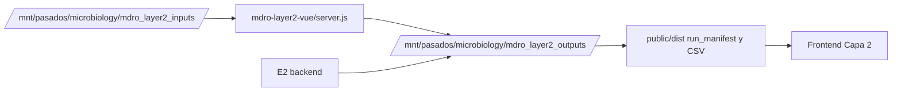

# Módulo 2 — Capa 2

## Cadena observada

## CURRENT

- Proceso Node activo: `/home/suryka/modulo2/mdro-layer2-vue/server.js` en `:5182`.
- Se localizaron `public/data/run_manifest.json` y `dist/data/run_manifest.json`.
- El backend directo E2 `:8996` devuelve HTTP 500 con `No static resource` para `/api/e2/m2/runs`, mientras `/api/m2/runs` devuelve HTTP 200. La causa es el desacuerdo de prefijo entre frontend y backend activo.
- La ruta pública nginx `/api/e2/m2/runs` devuelve HTTP 200 porque nginx encamina el prefijo a la ruta operativa; no se aplicó ningún cambio en esta tarea.
- `WOS_M2_OUTPUT_ROOT` existe y contiene manifiestos legibles, por lo que no es la causa del HTTP 500.
- No se confirmó que la ruta histórica `/home/suryka/modulo2/mdro-layer2-vue` sea la fuente Git activa.

## Contrato

El código local define archivos por run, miembros, aislamientos, calidad, trazabilidad y claves `treatment_instance`/`idFarmaco`. La asociación no debe basarse en paciente o medicamento solos.

## Estado diario actual

El circuito real Windows → entrada E2 → Layer1/R → `final_tables` → Layer2 →
publicación atómica está validado. El último run real produjo 185 aislados y
0 alertas MDRO; el cero se confirmó con tablas no vacías, manifiesto válido,
replay idempotente y publicación conservada.

La operación posterior utiliza polling y watermark. El monitor de correo solo
evalúa runs publicados con provenance real y está documentado en
`M2_EMAIL_MONITOR.md`.
