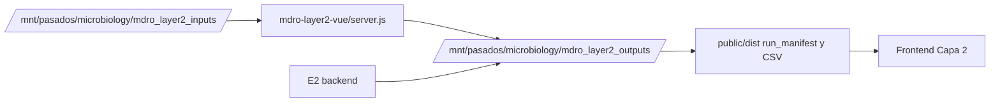

# Módulo 2 — Capa 2

## Cadena observada

## CURRENT

- Proceso Node activo: `/home/suryka/modulo2/mdro-layer2-vue/server.js` en `:5182`.
- Se localizaron `public/data/run_manifest.json` y `dist/data/run_manifest.json`.
- La API E2 `/api/e2/m2/runs` devolvió HTTP 500 con `No static resource`.
- No se confirmó que la ruta histórica `/home/suryka/modulo2/mdro-layer2-vue` sea la fuente Git activa.

## Contrato

El código local define archivos por run, miembros, aislamientos, calidad, trazabilidad y claves `treatment_instance`/`idFarmaco`. La asociación no debe basarse en paciente o medicamento solos.
